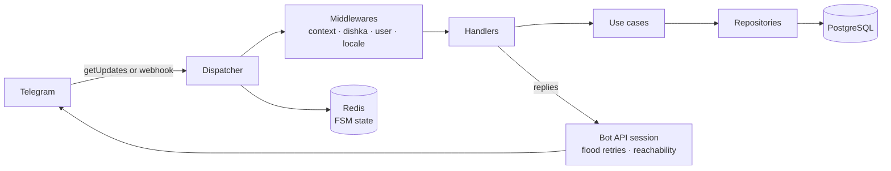

# tg-bot-template

A production-ready template for Telegram bots on aiogram 3. One codebase runs
in polling or webhook mode, chosen by a single setting. PostgreSQL stores the
users and Redis keeps the dialog (FSM) state. Dependencies are wired with
dishka, from the database session down to the use case a handler calls.
English and Russian work out of the box, and adding a language is a catalog
and two lines of code. Unit tests run against a fake Bot API, integration
tests against a real PostgreSQL and Redis, and GitHub Actions runs both on
pull requests.

## Features

- Polling and webhook modes with graceful shutdown: on SIGTERM the bot stops
  taking updates and gives the ones in progress `SHUTDOWN_TIMEOUT_SECONDS` to
  finish.
- `/start`, `/help` and `/language`, with a per-user language and a command
  menu published in every supported language.
- Users stored on their first private-chat update and kept fresh with
  minimal writes: a row is rewritten only when the Telegram profile changes
  or once per `USER_TOUCH_INTERVAL_SECONDS`.
  A snapshot of the stored user is cached in Redis for
  `USER_CACHE_TTL_SECONDS`, so most updates read no row at all.
- Tracking of users the bot can no longer reach (they blocked the bot or
  deleted their account) in `is_reachable` and `unreachable_since`, for code
  that messages users unprompted. A user becomes reachable again with their
  next update or when they unblock the bot.
- Flood-control retries: a Bot API call that hits `RetryAfter` waits as long
  as Telegram asks and tries again, up to `TELEGRAM_RETRY_ATTEMPTS` times. All
  calls of one update share 30 seconds of waiting.
- A global error handler that logs the failure, answers the user in their
  Telegram language, and reports unexpected errors to Sentry.
- `/live`, `/ready` and `/health` probes in both modes.
- Strict typing (mypy), import-layer contracts (import-linter), a fake Bot
  API for tests and a 90% coverage gate.
- GitHub Actions CI on pull requests and pushes to `main`: pre-commit hooks,
  a single Alembic head, unit tests with coverage, integration tests against
  PostgreSQL and Redis, Bandit, pip-audit and Gitleaks. A push to `main` that
  passes them builds the image and pushes it to GHCR, tagged `latest` and
  `sha-` plus the first 12 characters of the commit. A change that touches
  only documentation runs the lint and Gitleaks jobs alone.

## Architecture



Handlers are thin and get their use cases from the dishka container. A use
case owns the transaction through a unit of work. Repositories hold all SQL.

## Quick start (polling)

You need Docker with Compose v2, Python 3.13 for the tooling, and a bot token
from [@BotFather](https://t.me/BotFather).

```bash
git clone https://github.com/darkweid/tg-bot-template.git my-bot && cd my-bot
python3.13 -m venv .venv && source .venv/bin/activate
pip install -r infra/requirements/dev.txt
cp .env.example .env          # set BOT_TOKEN
make run-dev                  # compiles catalogs, migrates, starts with autoreload
make logs s=bot
```

The dev stack always polls. A change to a `.py` file under `src/`,
`loggers/` or `models/` restarts the bot. After editing a `.po` file, run
`make i18n-compile restart s=bot`.

## Webhook mode

Set three variables in `.env`:

- `BOT_MODE=webhook`;
- `WEBHOOK_BASE_URL`, the public HTTPS origin Telegram will call;
- `WEBHOOK_SECRET`, 32 to 256 letters, digits, `_` or `-`, which Telegram
  echoes on every update. Generate one with
  `python -c "import secrets; print(secrets.token_urlsafe(48))"`.

The bot refuses to start in webhook mode without an `https` base URL and a
secret. It sets the webhook on every start and keeps it on shutdown, so
Telegram queues updates while the next container starts.

Run the prod-like stack with `make run`. A one-shot `migrate` service applies
the migrations baked into the image before the bot starts, and the bot waits
for it; `make migrate` runs the same service by hand. With `BOT_IMAGE` set in
`.env` to an image CI pushed (`ghcr.io/<owner>/<repo>:sha-<12>`), `make run`
pulls and runs that image instead of building one from the checkout.

Put a reverse proxy with a valid certificate in front of the bot and forward
`WEBHOOK_PATH` (default `/webhook/telegram`) to `bot:${WEB_SERVER_PORT}` on the
`tg-bot-template-network` Docker network. The compose file publishes no port
of the bot.

## Background tasks

Background work runs on [taskiq](https://taskiq-python.github.io/) over Redis
Streams, in two more services of the same image:

- `worker` runs the tasks: one process, up to 20 tasks at once. Scale it with
  replicas. It waits for the migrations like the bot, and a delivery of a task
  that already completed or is running elsewhere is skipped.
- `scheduler` fires cron schedules and the worker's delayed retries. Run
  exactly one: taskiq has no duplicate-fire protection, so two schedulers fire
  every cron twice. Its healthcheck reads a heartbeat the scheduler loop
  writes every 30 seconds.

The queue lives in its own Redis database, `REDIS_TASKS_DATABASE` (default
`1`), which must differ from `REDIS_DATABASE` and `REDIS_FSM_DATABASE`.
`make run` and `make run-dev` start both services; `make logs s=worker` and
`make logs s=scheduler` show their output.

In the dev stack the worker restarts on a change to a `.py` file under `src/`,
`loggers/` or `models/`, like the bot. The scheduler does not run under
watchfiles: after changing a schedule, run `make restart s=scheduler`.

## Throttling

Each user gets `THROTTLE_DEFAULT_LIMIT` handler calls per
`THROTTLE_DEFAULT_WINDOW_SECONDS` (20 per 60 seconds). Over the limit the bot
warns once per window and drops the rest. A handler that calls a paid model
takes the stricter profile with `flags={"throttle": Throttle.LLM}`, limited by
`THROTTLE_LLM_LIMIT` and `THROTTLE_LLM_WINDOW_SECONDS` (5 per 60 seconds).
Admins and developers are never limited. Counters live in Redis; while it is
down each instance counts in memory, so the limit stays.

## Roles

Two optional roles, set in `.env` as comma-separated Telegram user ids:

- `ADMIN_IDS`: admins get the admin commands;
- `DEVELOPER_IDS`: developers get the developer commands.

Both skip throttling and bans. Each listed id gets a command menu of its own in
its private chat: the user commands plus those of its roles. An id that never
opened the bot cannot get a menu yet; the bot logs one warning and starts
anyway, and the menu is set on the next start after that user opens the bot.

The role menus are set for each listed id on every start. Removing an id from
`ADMIN_IDS` or `DEVELOPER_IDS` takes the role away at once, but Telegram keeps
showing that user the old menu: the bot never deletes a menu it set. Clear it
once by hand with `deleteMyCommands` for the scope
`{"type": "chat", "chat_id": <id>}` and every language code the bot set.

## Project layout

```text
.github/            CI workflows and the docs-only change action
infra/              Dockerfiles, compose files, Postgres and Redis config, requirements
locales/            gettext catalogs, one directory per language
loggers/            logging setup: plain-text or JSON lines on stdout
migrations/         Alembic environment and revisions
models/             every SQLAlchemy model, imported for Alembic autogenerate
scripts/ops/        helpers behind make targets and pre-commit hooks
src/core/           shared infrastructure: database, Redis, task queue, errors, i18n, Telegram helpers
src/admin/          admin role: commands and handlers
src/developer/      developer role: commands and handlers
src/main/           entry points (bot, worker, scheduler), config, dependency container, dispatcher
src/system/         health checks behind the probes
src/user/           users: handlers, keyboards, middleware, use cases, repository
tests/unit/         tests that need no Docker
tests/integration/  tests against a throwaway PostgreSQL and Redis
tests/fakes/        the fake Bot API session and database fakes
```

## Development

```bash
pre-commit install            # run the hooks on every commit
make help                     # every target with a one-line description
make lint                     # every pre-commit hook over every file
make test                     # unit tests, no Docker needed
make test-cov                 # unit tests with a coverage report
make test-integration         # integration tests (needs Docker)
make i18n-update              # merge new and changed messages into the catalogs
make migration m="add something"  # new Alembic revision, autogenerated
```

`make migration` runs in the dev image as your user: it starts Postgres,
migrates it to head and diffs the models against it. Autogenerate misses
renames and some type and server-default changes: read the revision before
committing it.

## Adding a language

1. `make i18n-init LOCALE=de` starts `locales/de/LC_MESSAGES/messages.po`.
2. Add `"de"` to `SUPPORTED_LOCALES` in `src/core/i18n/__init__.py`.
3. Add the language's own name to `LANGUAGE_NAMES` in `src/user/keyboards.py`,
   for example `"de": "Deutsch"`.
4. Translate the catalog and run `make i18n-compile`.

`make test` then checks the new catalog: the catalog tests report messages
missing from it or left over, fuzzy entries and changed placeholders, and a
keyboard test fails while a supported language has no name.
