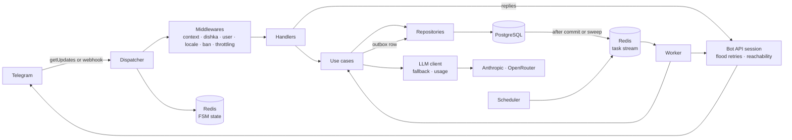

# telegram-bot-template

[](https://github.com/darkweid/telegram-bot-template/actions/workflows/prod_ci.yml)
[](LICENSE)


A template for Telegram bots on aiogram 3. One codebase runs in polling or
webhook mode, chosen by a single setting. PostgreSQL stores the users and Redis
keeps the dialog (FSM) state. Dependencies are wired with dishka, from the
database session down to the use case a handler calls. English and Russian ship
with the template, and adding a language is a catalog and three lines of code.
Unit tests run against a fake Bot API, integration tests against a real
PostgreSQL and Redis, and GitHub Actions runs both on pull requests. Ansible
prepares a fresh Ubuntu server, and CD deploys every push that passes CI once
you switch it on.

## Features

- Polling and webhook modes; on SIGTERM the bot stops taking updates and gives
  the ones in progress, and the background work they started,
  `SHUTDOWN_TIMEOUT_SECONDS` to finish.
  [Details](docs/bot-layer.md#modes)
- `/start`, `/help` and `/language`, with a per-user language and a command
  menu published in every supported language. [Details](docs/i18n.md)
- A reference domain to copy, `src/note`: a dialog with Cancel, a list paged
  five at a time, deletion after a confirmation, a domain event with its task,
  `/summarize` through the LLM, and the full set of tests.
  [Details](docs/architecture.md#adding-a-module)
- Users stored on their first private-chat update, rewritten only when the
  profile changes or once per `USER_TOUCH_INTERVAL_SECONDS`, and cached in
  Redis, so most updates read no row. [Details](docs/bot-layer.md#middleware-chain)
- Reachability tracking (`is_reachable`, `unreachable_since`) for users who
  blocked the bot, and flood-control retries on every Bot API call.
  [Details](docs/bot-layer.md#middleware-chain)
- Roles from configuration: admins ban and unban, see statistics and send
  broadcasts; developers get alerts and `/status`. Each role has its own
  command menu. [Details](docs/bot-layer.md#roles)
- Per-user throttling with a stricter profile for handlers that call a paid
  model. [Details](docs/bot-layer.md#throttling)
- Background tasks on taskiq: a `worker`, exactly one `scheduler`, and a
  transactional outbox, so a task runs only for work that was committed.
  [Details](docs/background-jobs.md)
- Developer alerts in Telegram for unexpected errors, tasks that failed for
  good, a switch to the LLM fallback provider and Redis degradation, once per
  `ALERT_COOLDOWN_SECONDS` for the same failure.
  [Details](docs/bot-layer.md#errors-and-alerts)
- Broadcasts to every reachable user, paced under Telegram's limit, with live
  progress and a Stop button, resumed from the last checkpoint after a worker
  restart. [Details](docs/broadcast.md)
- An LLM client for Anthropic and OpenRouter: structured output validated by
  pydantic, tools and an agent loop over them, images, two model tiers, a fallback provider, and the cost
  of every call recorded and shown in `/stats`. Off until `LLM_PROVIDER` is set. [Details](docs/llm.md)
- S3 storage and SMTP email with HTML templates, both off by default.
  [S3](docs/background-jobs.md#file-storage-s3), [email](docs/background-jobs.md#email)
- One error handler that logs the failure, answers in the user's Telegram
  language and reports unexpected errors to Sentry.
  [Details](docs/bot-layer.md#errors-and-alerts)
- `/live`, `/ready` and `/health` probes in both modes; `/health` also reports
  the outbox backlog, the task queue and the scheduler heartbeat.
  [Details](docs/bot-layer.md#health)
- Strict typing (mypy), import-layer contracts (import-linter), a fake Bot API
  for tests and a 90% coverage gate. [Details](docs/testing.md)
- GitHub Actions CI on pull requests and pushes to `main` and `stage`:
  pre-commit hooks, a single Alembic head, unit and integration tests, the
  nginx configuration, Bandit, pip-audit and Gitleaks; a push that passes
  builds the image and pushes it to GHCR.
  [Details](docs/deployment.md#continuous-integration)
- Deployment to your own server: Ansible roles, nginx with Let's Encrypt in
  webhook mode, a deploy script with migrations first and a rollback to the
  previous image, CD behind a per-environment switch, and releases that tag
  the image CI built. [Details](docs/deployment.md)
- Recipes for taking out the modules a bot does not need.
  [Details](docs/removing-modules.md)

## Architecture



Handlers are thin and get their use cases from the dishka container. A use
case owns the transaction through a unit of work. Repositories hold all SQL.

Background work follows the same path: the worker runs a task through a use
case from the same container, and the scheduler only queues tasks. The layers,
the scopes and the import contracts are in
[the architecture guide](docs/architecture.md).

## Quick start (polling)

You need Docker with Compose v2, Python 3.13 for the tooling, and a bot token
from [@BotFather](https://t.me/BotFather).

```bash
# "Use this template" on GitHub, then:
git clone https://github.com/<you>/my-bot.git && cd my-bot
make init-project NAME=my-bot        # renames the project, writes .env with generated secrets
python3.13 -m venv .venv && source .venv/bin/activate
pip install -r infra/requirements/dev.txt
# put the token from @BotFather into BOT_TOKEN in .env
make run-dev                         # compiles catalogs, migrates, starts with autoreload
make logs s=bot
```

`make init-project` runs once, on a clean clone, with the system `python3`
(3.9 or newer):

- it replaces `telegram-bot-template` with `NAME` in every tracked file, so the
  compose project, the images, the volumes and the network carry the bot's
  name; links to this repository stay as they are;
- it sets `PROJECT_NAME` in `.env.example` and writes `.env` from it with
  freshly generated `POSTGRES_PASSWORD`, `REDIS_PASSWORD` and
  `WEBHOOK_SECRET`; in an existing `.env` a secret is generated only where
  the value is empty or still a placeholder, while `PROJECT_NAME` is set to
  `NAME` there too, since the rename is the point of the run;
- `LOCALE=ru` (any supported locale) sets `DEFAULT_LOCALE` in both files, an
  existing `.env` included;
- it replaces this README with a short one for the bot, removes its own make
  target, and deletes itself and its test.

The result is one diff: review it with `git status` and `git diff`, and commit
it. `LICENSE`, `SECURITY.md` and `.github/ISSUE_TEMPLATE` still describe the
template: rewrite them for your bot, or delete them together with the links
to them; `make lint` names each link.

The stack publishes PostgreSQL on 5432 and Redis on 6379 of `127.0.0.1`.
When either port is taken, set `POSTGRES_HOST_PORT` or `REDIS_HOST_PORT` in
`.env` ([compose settings](docs/configuration.md#compose-and-resource-limits)).

The dev stack always polls. A change to a `.py` file under `src/`, `loggers/`
or `models/` restarts the bot and the worker; after changing a schedule, run
`make restart s=scheduler`. After editing a `.po` file, run
`make i18n-compile restart s=bot`.

## Switching to webhook

1. `BOT_MODE=webhook` in `.env`.
2. `WEBHOOK_BASE_URL`, the public `https` origin Telegram calls, on port 443.
3. `WEBHOOK_SECRET`: `make init-project` already generated one.
4. `COMPOSE_PROFILES=webhook`, which adds nginx and certbot to the stack;
   start it with `make run`, since `make run-dev` always polls.
5. Once DNS points at the server and port 80 is open:
   `make cert-issue DOMAIN=bot.example.com`.

What nginx lets through, the certificate and the deploy are in
[the deployment guide](docs/deployment.md#webhook-mode).

## Project layout

```text
.github/            CI, CD, release, Ansible and update workflows, Dependabot
docs/               the guides listed below
infra/              Dockerfiles, compose files, nginx, Ansible, deploy.sh, requirements
locales/            gettext catalogs, one directory per language
loggers/            logging setup: plain-text or JSON lines on stdout
migrations/         Alembic environment and revisions
models/             every SQLAlchemy model, imported for Alembic autogenerate
scripts/            make init-project, and the .env checker and hook helpers in ops/
src/admin/          admin commands: ban, unban, statistics
src/broadcast/      broadcasts: model, use cases, tasks, the draft dialog
src/core/           shared infrastructure: database, outbox, tasks, Redis, cache,
                    rate limits, HTTP, LLM, S3, email, errors, i18n, Telegram
src/developer/      developer commands: status, test alert
src/main/           entry points (bot, worker, scheduler), config, dependency
                    container, dispatcher, polling and webhook
src/note/           notes, the reference domain to copy
src/system/         health checks behind the probes and /status
src/user/           users: handlers, keyboards, middlewares, use cases, repository
tests/              unit and integration tests, fakes, factories, helpers
```

Every directory, `src/core` package and test helper is described in
[the project layout](docs/architecture.md#project-layout).

## Adding a module

A new domain registers itself in a fixed set of places, as `src/note` does:

- its model in `models/__init__.py`, and a migration (`make migration m="..."`);
- its provider in `build_container` (`src/main/di.py`);
- its router in `create_dispatcher` (`src/main/dispatcher.py`), after the
  user router and before the `unmatched` router;
- its commands in `PUBLIC_COMMANDS` (`src/main/commands.py`);
- its event subscribers in `EVENT_SUBSCRIBERS`
  (`src/main/event_subscribers.py`) and its tasks in `TASKS`
  (`src/main/tasks.py`);
- its packages in the contracts of `.importlinter`.

The step-by-step checklist is in
[adding a module](docs/architecture.md#adding-a-module); taking one out is in
[removing modules](docs/removing-modules.md).

## Documentation

| Guide | What it covers |
|---|---|
| [Architecture](docs/architecture.md) | Layers, dependency injection, the unit of work, events and the outbox, import contracts, the project layout, adding a module |
| [The bot layer](docs/bot-layer.md) | Polling and webhook, startup and shutdown, the middleware chain, roles, throttling, errors and alerts, health probes |
| [Background jobs](docs/background-jobs.md) | The worker and the scheduler, declaring a task, the outbox, schedules, failure alerts, S3 and email |
| [Broadcasts](docs/broadcast.md) | Sending a broadcast, how a run survives a restart, pacing |
| [The LLM layer](docs/llm.md) | Turning it on, calling a model, structured output, fallback, usage and cost |
| [Translations](docs/i18n.md) | Marking strings, updating catalogs, adding a language |
| [Configuration](docs/configuration.md) | Every `.env` key with its default, and the deploy-time `.env` check |
| [Deployment](docs/deployment.md) | Webhook mode and nginx, server provisioning, the deploy script, CD, releases |
| [Testing](docs/testing.md) | Running the suites, handler and integration tests, fakes, coverage |
| [Contributing](docs/contributing.md) | Lint hooks, migrations, dependencies, commits and pull requests |
| [Removing modules](docs/removing-modules.md) | Taking out the note module or broadcasts, and the features that ship off |

## Security

Report a vulnerability privately, as described in
[the security policy](SECURITY.md#reporting-a-vulnerability).

## License

MIT, see [LICENSE](LICENSE).
