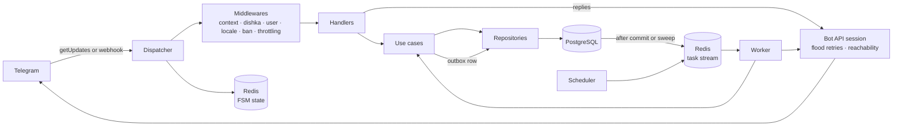

# tg-bot-template

A production-ready template for Telegram bots on aiogram 3. One codebase runs
in polling or webhook mode, chosen by a single setting. PostgreSQL stores the
users and Redis keeps the dialog (FSM) state. Dependencies are wired with
dishka, from the database session down to the use case a handler calls.
English and Russian work out of the box, and adding a language is a catalog
and two lines of code. Unit tests run against a fake Bot API, integration
tests against a real PostgreSQL and Redis, and GitHub Actions runs both on
pull requests.

## Features

- Polling and webhook modes with graceful shutdown: on SIGTERM the bot stops
  taking updates and gives the ones in progress `SHUTDOWN_TIMEOUT_SECONDS` to
  finish.
- `/start`, `/help` and `/language`, with a per-user language and a command
  menu published in every supported language.
- Users stored on their first private-chat update and kept fresh with
  minimal writes: a row is rewritten only when the Telegram profile changes
  or once per `USER_TOUCH_INTERVAL_SECONDS`.
  A snapshot of the stored user is cached in Redis for
  `USER_CACHE_TTL_SECONDS`, so most updates read no row at all.
- Tracking of users the bot can no longer reach (they blocked the bot or
  deleted their account) in `is_reachable` and `unreachable_since`, for code
  that messages users unprompted. A user becomes reachable again with their
  next update or when they unblock the bot.
- Flood-control retries: a Bot API call that hits `RetryAfter` waits as long
  as Telegram asks and tries again, up to `TELEGRAM_RETRY_ATTEMPTS` times. All
  calls of one update share 30 seconds of waiting.
- Roles from configuration: admins (`ADMIN_IDS`) ban and unban users, see
  user statistics and send broadcasts; developers (`DEVELOPER_IDS`) get alerts
  and `/status`. Each role sees its own command menu.
- Per-user throttling with named profiles (`THROTTLE_*`); admins and
  developers are not limited.
- Background tasks on taskiq over a Redis stream: a `worker` and a single
  `scheduler`. A use case queues a task through a transactional outbox, so a
  task runs only for work that was committed.
- Admins are told when a new user starts the bot
  (`NOTIFY_ADMINS_ON_NEW_USER`).
- Developer alerts in Telegram for unexpected errors, tasks that failed for
  good and Redis degradation, once per `ALERT_COOLDOWN_SECONDS` for the same
  error.
- Broadcasts to every reachable user, paced under Telegram's limit, with live
  progress and a Stop button, resumed from the last checkpoint after a worker
  restart.
- A global error handler that logs the failure, answers the user in their
  Telegram language, and reports unexpected errors to Sentry.
- `/live`, `/ready` and `/health` probes in both modes; `/health` also reports
  the outbox backlog, the task queue and the scheduler heartbeat.
- Strict typing (mypy), import-layer contracts (import-linter), a fake Bot
  API for tests and a 90% coverage gate.
- GitHub Actions CI on pull requests and pushes to `main`: pre-commit hooks,
  a single Alembic head, unit tests with coverage, integration tests against
  PostgreSQL and Redis, Bandit, pip-audit and Gitleaks. A push to `main` that
  passes them builds the image and pushes it to GHCR, tagged `latest` and
  `sha-` plus the first 12 characters of the commit. A change that touches
  only documentation runs the lint and Gitleaks jobs alone.
- Continuous deployment to a server over SSH after CI, one workflow per
  environment, off until a repository variable turns it on.

## Architecture



Handlers are thin and get their use cases from the dishka container. A use
case owns the transaction through a unit of work. Repositories hold all SQL.

Background work follows the same path: the worker runs a task through a use
case from the same container, and the scheduler only queues tasks.

## Quick start (polling)

You need Docker with Compose v2, Python 3.13 for the tooling, and a bot token
from [@BotFather](https://t.me/BotFather).

```bash
git clone https://github.com/darkweid/tg-bot-template.git my-bot && cd my-bot
python3.13 -m venv .venv && source .venv/bin/activate
pip install -r infra/requirements/dev.txt
cp .env.example .env          # set BOT_TOKEN
make run-dev                  # compiles catalogs, migrates, starts with autoreload
make logs s=bot
```

The dev stack always polls. A change to a `.py` file under `src/`,
`loggers/` or `models/` restarts the bot. After editing a `.po` file, run
`make i18n-compile restart s=bot`.

## Webhook mode

Set three variables in `.env`:

- `BOT_MODE=webhook`;
- `WEBHOOK_BASE_URL`, the public HTTPS origin Telegram will call;
- `WEBHOOK_SECRET`, 32 to 256 letters, digits, `_` or `-`, which Telegram
  echoes on every update. Generate one with
  `python -c "import secrets; print(secrets.token_urlsafe(48))"`.

The bot refuses to start in webhook mode without an `https` base URL and a
secret. It sets the webhook on every start and keeps it on shutdown, so
Telegram queues updates while the next container starts.

Run the prod-like stack with `make run`. A one-shot `migrate` service applies
the migrations baked into the image before the bot starts, and the bot waits
for it; `make migrate` runs the same service by hand. With `BOT_IMAGE` set in
`.env` to an image CI pushed (`ghcr.io/<owner>/<repo>:sha-<12>`), `make run`
pulls and runs that image instead of building one from the checkout.

Every service except the image builder has a CPU and memory cap taken from
`.env` (`BOT_CPUS`, `BOT_MEMORY`, `WORKER_MEMORY`, ...; the commented block at
the end of `.env.example` lists them with their defaults). Lower them on a
small box instead of editing `infra/docker-compose.yml`.

### nginx and the certificate

The `webhook` compose profile adds nginx and certbot. Set
`COMPOSE_PROFILES=webhook` in `.env` together with `BOT_MODE=webhook`, and
`make run`, `up`, `down`, `logs` and `restart` handle both with the rest of the
stack. The dev stack always polls and leaves them out.

nginx publishes ports 80 and 443, the only ports of the stack open to the
internet. It passes `WEBHOOK_PATH` (default `/webhook/telegram`) to the bot
only for POST requests from Telegram's subnets (`TELEGRAM_ALLOWED_SUBNETS`),
serves `/live`, `/ready` and `/health` to private addresses only, and closes
every other connection without an answer. Port 80 serves certbot's challenge
and nothing else.

`make check-env` checks `.env` before anything starts from it: the token and
webhook formats, `COMPOSE_PROFILES` against `BOT_MODE`, the subnets, the
container limits, and placeholders from `.env.example` left in a password or
in the key of an enabled feature. It names the key at fault and never prints a
value. The deploy script runs it first.

Issue the first certificate once DNS for the webhook host points at the box
and port 80 is open; `DOMAIN` is the host of `WEBHOOK_BASE_URL`:

    make cert-issue DOMAIN=bot.example.com EMAIL=you@example.com

Until a certificate exists, nginx serves port 80 only. certbot tries to renew
twice a day and nginx reloads every six hours, so a renewed certificate is in
use within six hours. `make clean` keeps the certificate volume: Let's Encrypt
issues a certificate for the same host at most five times a week.

## Deployment

On the box, from the checkout:

    bash infra/deploy/deploy.sh

It checks `.env` (`make check-env`), and in webhook mode tests the nginx
configuration and refuses to go on without a certificate (`make cert-issue`).
Then it builds the Postgres image, builds the bot image or pulls `BOT_IMAGE`,
starts Postgres and Redis, applies the migrations, and replaces the bot, the
worker and the scheduler. A failed check or migration stops it with the
previous stack still running.

- In webhook mode the new bot starts beside the old one and nginx moves to it
  once it is healthy, so no update is refused. In polling mode the bot is
  replaced in place: two pollers on one token conflict.
- When the new bot, worker or scheduler never turns healthy, the stack goes
  back to the image it ran before. Migrations stay applied.
- `BUILD=1` builds the image on the box (the default without `BOT_IMAGE`);
  `BUILD=0` pulls `BOT_IMAGE`, the image CI pushed:
  `BUILD=0 BOT_IMAGE=ghcr.io/<owner>/<repo>:sha-<12> bash infra/deploy/deploy.sh`.
- At the end it removes images and build cache unused for a week, on Linux
  only; `PRUNE=0` keeps them.

## Continuous deployment

CD is off until you turn it on. After CI passes on a push, `CD (prod)` deploys
`main` and `CD (stage)` deploys `stage`: each pulls the image that CI run pushed
to GHCR (`sha-<12>`) on the server and runs `infra/deploy/deploy.sh` with
`BUILD=0`, so the server never builds. A push of documentation only builds no
image and deploys nothing. A deploy waits for the one already running; of
several waiting, only the newest runs. A running deploy is never cancelled.

To turn it on for an environment:

1. Provision the server (`infra/ansible/README.md`): it ends with the values
   below printed.
2. Settings -> Environments -> `production` (or `staging`):
   - secrets `SSH_PRIVATE_KEY` (the CD key whose public half is in the
     inventory), `SSH_KNOWN_HOSTS`, `SSH_USER` (`deploy`), `SERVER_IP`;
   - variables `APP_DIR` (`/srv/<app_name>`) and `SSH_PORT` (when not 22);
   - optionally secrets `ALERT_BOT_TOKEN` and `ALERT_CHAT_ID`: a Telegram bot
     and chat that get one message per deploy. Without them the deploy runs and
     its log says no alert was sent.

   Set them on the environment or the repository, not the organization: an
   organization on the Free plan does not pass its secrets to a private
   repository, and they arrive empty.
3. Deployment branches of the environment: `main` for `production`; **both
   `main` and `stage`** for `staging`. The deploy is triggered by
   `workflow_run`, which GitHub always runs on the default branch, so an
   environment limited to `stage` rejects it.
4. Settings -> Secrets and variables -> Actions -> Variables: set
   `PROD_DEPLOY_ENABLED` (or `STAGE_DEPLOY_ENABLED`) to `true`.

To redeploy an earlier build, run the CD workflow by hand (Actions -> CD (prod)
-> Run workflow) with `image_tag` set to its `sha-<12>` tag.

## Roles

Two optional roles, set in `.env` as comma-separated Telegram user ids:

- `ADMIN_IDS`: admins get the admin commands;
- `DEVELOPER_IDS`: developers get the developer commands: `/status` shows the
  `/health` report, `/test_alert` sends a test alert the way real alerts go,
  past the cooldown.

Neither is throttled, and a ban never drops their updates (see below for
broadcasts and statistics). Each listed id gets a command menu of its own in
its private chat: the user commands plus those of its roles. An id that never
opened the bot cannot get a menu yet; the bot logs one warning and starts
anyway, and the menu is set on the next start after that user opens the bot.

Admins ban and unban users with `/ban` and `/unban`, followed by a Telegram
user id or `@username` (matched ignoring case; a username that several stored
users have had is refused, use the id). Only users who have started the bot
can be named. Admins and developers cannot be banned, and nobody bans
themselves. A banned user's updates are dropped without an answer. A ban or
unban made while Redis is down holds during the outage, when every update
reads the stored row. The snapshot cached before it is never served again:
the bot remembers that its delete failed and drops it once Redis is back, and
the worker drops it too. Only a bot restarted during the outage forgets that,
and then serves the old snapshot until the worker drops it, usually within a
couple of minutes of Redis coming back. A role beats a ban for updates only: someone banned before their id
was added to `ADMIN_IDS` or `DEVELOPER_IDS` is served as usual, but
broadcasts skip them and `/stats` counts them as banned until they are
unbanned with `/unban`.

Admins also get `/stats`: users in total, reachable, banned, and active and
new in the last 1, 7 and 30 days.

The role menus are set for each listed id on every start. Removing an id from
`ADMIN_IDS` or `DEVELOPER_IDS` takes the role away at once, but Telegram keeps
showing that user the old menu: the bot never deletes a menu it set. Clear it
once by hand with `deleteMyCommands` for the scope
`{"type": "chat", "chat_id": <id>}` and every language code the bot set.

## Throttling

Each user gets `THROTTLE_DEFAULT_LIMIT` handler calls per
`THROTTLE_DEFAULT_WINDOW_SECONDS` (20 per 60 seconds). Over the limit the bot
warns once per window and drops the rest. A handler that calls a paid model
takes the stricter profile with `flags={"throttle": Throttle.LLM}`, limited by
`THROTTLE_LLM_LIMIT` and `THROTTLE_LLM_WINDOW_SECONDS` (5 per 60 seconds).
Admins and developers are never limited. Counters live in Redis; while it is
down each instance counts in memory, so the limit stays.

## Background tasks

Background work runs on [taskiq](https://taskiq-python.github.io/) over Redis
Streams, in two more services of the same image:

- `worker` runs the tasks: one process, up to 20 tasks at once. Scale it with
  replicas. It waits for the migrations like the bot, and a delivery of a task
  that already completed or is running elsewhere is skipped.
- `scheduler` fires cron schedules and the worker's delayed retries. Run
  exactly one: taskiq has no duplicate-fire protection, so two schedulers fire
  every cron twice. Its healthcheck reads a heartbeat the scheduler loop
  writes every 30 seconds.

The queue lives in its own Redis database, `REDIS_TASKS_DATABASE` (default
`1`), which must differ from `REDIS_DATABASE` and `REDIS_FSM_DATABASE`; the
configuration refuses two roles on one database at startup.
`make run` and `make run-dev` start both services; `make logs s=worker` and
`make logs s=scheduler` show their output.

In the dev stack the worker restarts on a change to a `.py` file under `src/`,
`loggers/` or `models/`, like the bot. The scheduler does not run under
watchfiles: after changing a schedule, run `make restart s=scheduler`.

A use case enqueues a task inside its unit of work:

```python
async with self._uow as uow:
    ...
    await uow.enqueue_task("reports.send", user_id=user.id)
    await uow.commit()
```

The task is stored as a row in `outbox_messages` in the same transaction, so it
exists only if the work that caused it commits. Arguments must be plain JSON
values (ids, strings, numbers, lists, dicts); anything a JSON round-trip would
change is refused. Right after commit the bot sends the task to the queue. If
that send fails, the `outbox.sweep` task, which runs every minute, sends the row
within a minute or two; the row id is the task id, so a row sent twice runs
once. `outbox.purge` deletes published rows older than
`PUBLISHED_RETENTION_DAYS` (7) every day at 03:00 UTC. A row still pending
after that many days is never sent: the sweeper marks it failed and logs it at
CRITICAL, since the worker remembers a finished task only as long and a late
send could run it twice.

Every task is registered in one place: a `TaskSpec` in `TASKS`
(`src/main/tasks.py`), with its name, function, optional cron schedule and
retry flag. A name missing there is never run, and the sweeper marks its rows
failed. A task runs at least once by default: a worker that stops midway leaves
it to be run again. `at_most_once=True` records it as done before it runs, for
a message a person reads, where a lost message beats a repeated one; it cannot
be combined with a retry.

A domain event is the other way to start a task. A use case publishes it
inside its unit of work (`uow.publish`); the event's subscribers, mapped in
`src/main/event_subscribers.py`, run in that same transaction and enqueue
tasks. The reference path is the new-user notice: `TouchUserUseCase` publishes
`UserRegistered` when the upsert inserted the user, `enqueue_new_user_notice`
stores `user.notify_admins_of_new_user` in the outbox, and the worker sends
every admin in `ADMIN_IDS` who has opened the bot a message in that admin's
language. The task runs at most once: run again, it would repeat the message
to the admins who already got it. `NOTIFY_ADMINS_ON_NEW_USER=false` keeps the event
and the task and sends nothing.

## Alerts

The bot and the worker tell developers in Telegram when:

- a handler raises an unexpected error (a `CoreException` is an expected
  refusal and alerts nobody);
- a task fails for good, after its last retry;
- Redis goes down under the cache or the throttle limiter, and again when it
  recovers.

Alerts go to `DEV_ALERT_CHAT_ID`, a group or channel id, when it is set, and
otherwise to each of `DEVELOPER_IDS` in private. The bot must be a member of
the alert chat, and a developer must have opened the bot: an alert Telegram
refuses is logged and nothing more.

An error alert carries the error type, where it was raised, what was being
handled (`update message`, `task <name>`), the user id or task id, and the
Sentry event id when Sentry is on. The error message is shown (cut to 500
characters) only for a `CoreException`, whose message the project writes, and
for a driver or validation error, whose message is rebuilt from safe fields;
any other message can quote what the user sent (`int(message.text)`), so the
alert says it is in the logs (and in Sentry, when on) instead. It never
carries what the user sent or their name. The same failure (type, place and
origin) is alerted once per `ALERT_COOLDOWN_SECONDS` (300), and a task once
however often it is redelivered.

## Broadcast

`/broadcast` (admins) sends one message to every user who can receive it:
reachable and not banned.

1. Send `/broadcast`, then the message: text, a photo or video with a caption,
   a document. Albums are refused. The bot shows an exact copy and the number of
   recipients.
2. Press Send. The bot copies the message to every recipient and keeps a
   progress message with a Stop button, updated at most every 5 seconds. When
   the broadcast ends, the progress message turns into the report and the bot
   sends the report again, so the admin gets a notification.

Only one broadcast runs at a time. It goes to the users the bot had when Send
was pressed; someone who starts the bot later does not get it. Do not delete
the original message until the broadcast has finished: every copy is made from
it, and if it is gone, the broadcast stops as failed and developers are
alerted.

The total in the progress message is the number of recipients when Send was
pressed. Users are walked in order of their id, so a change mid-run counts only
for users the walk has not reached yet: one who unblocks the bot is reached
too, one who blocks it or is banned is skipped; the
progress never reads past its total, and the final report of a completed
broadcast counts the users who were actually walked.

The worker sends `BROADCAST_RATE_PER_SECOND` messages a second (25 by default;
Telegram allows about 30 to different users) and saves its position every
`BROADCAST_CHECKPOINT_EVERY` recipients (50), at least once a minute, and after
every user who blocked the bot. If the worker stops mid-broadcast, a scheduled
task resumes it within about five minutes from the last saved position, so up
to `BROADCAST_CHECKPOINT_EVERY` users may get the message twice. Stop takes effect at the next save, within
about a minute, flood waits included. The final report edits the
progress message, and is recorded once Telegram has taken the edit or refused
it for good (a deleted progress message, a blocked bot). If the worker stops
after a broadcast finished but before the edit landed, or the edit met a
network error, the same task edits it about five minutes later, from the stored
counts. The report message that notifies the admin goes out after the record,
at most once: a worker that stops in between leaves the edited progress message
as the only report.

A user who blocked the bot is counted as unreachable and marked so; a chat
Telegram cannot find counts as failed. Network errors are retried. Anything
else marks the broadcast failed, sends the report and alerts developers.

## Health

The bot serves three probes on `WEB_SERVER_PORT` in both modes, on the compose
network only:

- `/live` answers 200 while the process runs; the Docker healthcheck reads it.
- `/ready` answers 200 when PostgreSQL and every Redis database (cache, FSM
  state, task queue) answer, and 503 otherwise.
- `/health` always answers 200 with a JSON report: `status` (`ok` or
  `degraded`), `version`, `commit`, `mode`, `postgres`, `redis`,
  `redis_memory_used_ratio`, `outbox_pending`, `outbox_oldest_pending_seconds`,
  `task_queue_length` and `scheduler_heartbeat_age_seconds`. A reading that
  failed or timed out is `null`, and so is every Redis reading while any
  Redis database is down.

`task_queue_length` is the workers' backlog: tasks their consumer group has
not delivered yet plus those delivered and not acknowledged. It is not the
stream's length, which keeps acknowledged tasks until the stream is trimmed.
It is `null` when Redis cannot count the undelivered ones, which happens after
some trims and deletions.

`/health` reports `degraded` when PostgreSQL or Redis is down, when Redis is at
90% of `maxmemory`, when the scheduler has not beaten for more than 90 seconds
(no cron task, delayed retry or outbox sweep runs without it), or when an
outbox row has waited for publishing longer than 5 minutes. The task queue
never changes the status: there is no backlog that is wrong for every bot.
Developers see the same report with `/status`.

## Releases

Tag a commit CI built and pushed (from `main` or `stage`) with `vX.Y.Z` and
push the tag. The `Release` workflow points `ghcr.io/<owner>/<repo>:vX.Y.Z` at
the image CI already pushed for that commit (`sha-<12>`, same digest, nothing
rebuilt) and opens a GitHub Release with generated notes. A tag on a commit CI
never built fails. Releases deploy nothing: CD follows the branches.

## Coverage

`make test-cov` enforces 90% over `src/`. Uploading the report to Coveralls is
off until the repository variable `COVERALLS_ENABLED` is `true`; a public
repository needs no token, the workflow token is enough. With it on, every push
gets a Coveralls build, including a squash merge whose tests CI skips because
the same tree already passed: the report of that tree is carried over.

## Dependency updates

Dependabot opens one grouped pull request a month for Python packages and one
for GitHub Actions; `pre-commit-autoupdate.yml` does the same for the hook
revisions (set `PRECOMMIT_BOT_TOKEN` for CI to run on its pull request).
Container images move by hand. A Dependabot bump of a package that
`.pre-commit-config.yaml` pins (`mypy`, `bandit`) leaves the hook out of sync;
run `python scripts/ops/sync_precommit_deps.py` on that pull request and commit
the result (`tests/unit/scripts/ops/test_sync_precommit_deps.py` fails until
you do).

## Project layout

```text
.github/            CI, deploy, release, Ansible and update workflows, the
                    Dependabot config, the docs-only change action
infra/              Dockerfiles, compose files, Postgres and Redis config, requirements
locales/            gettext catalogs, one directory per language
loggers/            logging setup: plain-text or JSON lines on stdout
migrations/         Alembic environment and revisions
models/             every SQLAlchemy model, imported for Alembic autogenerate
scripts/ops/        helpers behind make targets and pre-commit hooks
src/admin/          admin commands: ban, unban, statistics
src/broadcast/      broadcasts: model, use cases, tasks, the draft dialog
src/core/           shared infrastructure: database, outbox, tasks, Redis, cache,
                    rate limits, HTTP client, errors, i18n, Telegram helpers
src/developer/      developer commands: status, test alert
src/main/           entry points (bot, worker, scheduler), config, dependency
                    container, dispatcher, polling and webhook
src/system/         health checks behind the probes and /status
src/user/           users: handlers, keyboards, middleware, use cases, repository
tests/unit/         tests that need no Docker
tests/integration/  tests against a throwaway PostgreSQL and Redis
tests/fakes/        the fake Bot API session, database and Redis fakes
tests/factories/    Telegram updates and stored users for tests
tests/helpers/      a running bot on the fake API, provider overrides, log capture
```

## Development

```bash
pre-commit install            # run the hooks on every commit
make help                     # every target with a one-line description
make lint                     # every pre-commit hook over every file
make test                     # unit tests, no Docker needed
make test-cov                 # unit tests with a coverage report
make test-integration         # integration tests (needs Docker)
make i18n-update              # merge new and changed messages into the catalogs
make migration m="add something"  # new Alembic revision, autogenerated
```

`make migration` runs in the dev image as your user: it starts Postgres,
migrates it to head and diffs the models against it. Autogenerate misses
renames and some type and server-default changes: read the revision before
committing it.

`make` passes the checkout's commit (`git rev-parse --short=12 HEAD`) to the
image build as `COMMIT_SHA`, and CI passes the same 12 characters it puts in
the `sha-` tag; `/status` and `/health` show it, `unknown` without one. The
dev stack (`make run-dev`) runs the live checkout rather than a baked image, so
it always shows `unknown`. Leave
`COMMIT_SHA` out of `.env`: the compose services read that file, and a value
there would override the commit baked into the image.

## Adding a language

1. `make i18n-init LOCALE=de` starts `locales/de/LC_MESSAGES/messages.po`.
2. Add `"de"` to `SUPPORTED_LOCALES` in `src/core/i18n/__init__.py`.
3. Add the language's own name to `LANGUAGE_NAMES` in `src/user/keyboards.py`,
   for example `"de": "Deutsch"`.
4. Translate the catalog and run `make i18n-compile`.

`make test` then checks the new catalog: the catalog tests report messages
missing from it or left over, fuzzy entries and changed placeholders, and a
keyboard test fails while a supported language has no name.
