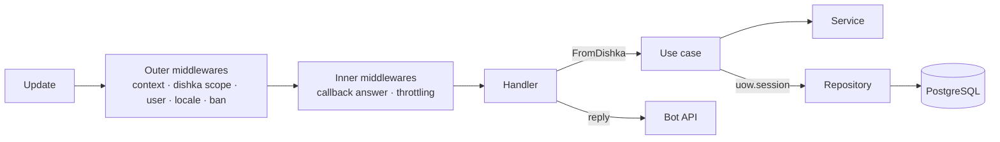
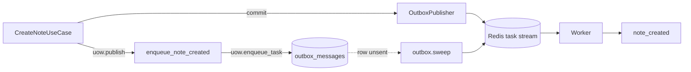

# Architecture

How the code is split into layers, how the dependency container ties them
together, how a use case owns its transaction and how work leaves it for the
worker. Open it before adding a domain module or when a layer rule or an import
contract refuses a change. The bot's own runtime (modes, middlewares, errors)
is in [the bot layer](bot-layer.md), the worker and the scheduler in
[background jobs](background-jobs.md).

## Layers

Every request goes Handler -> UseCase -> Service -> Repository.

- **Handlers** parse the update, call a use case obtained through
  `FromDishka[...]` and answer. They never touch a session or a repository.
  A handler with nothing to orchestrate calls a service directly instead of
  going through a use case that only forwards: `/status` in
  `src/developer/handlers.py` calls `HealthService` itself.
- **Use cases** are scenarios. A use case owns the transaction through a unit
  of work, orchestrates repositories and services and owns the side effects
  (events, tasks, cache invalidation). One use case per file, under
  `<module>/usecases/`, registered in the module's `di.py`.
- **Services** hold the pure rules of one module, without I/O:
  `check_note_text` in `src/note/services.py`, `needs_write` in
  `src/user/services.py`.
- **Repositories** hold all SQL. They are stateless; the session is the first
  argument of every method. The base class in `src/core/database/repositories.py`
  provides `create`, `exists`, `get_single`, `get_list`, `get_paginated_list`,
  `count`, `update` and `delete`; a custom method is written only where a base
  one cannot express the query.

No function or class exists only to forward a call to another one.

The path of one update through the layers:



`src/core` is shared infrastructure with no domain knowledge. `src/main` is
the composition root that wires the domains together:

- `src/user` - users: storing and refreshing them, `/start`, `/help` and
  `/language`, the user and ban middlewares, bans and reachability;
- `src/admin` - the admin commands `/ban`, `/unban` and `/stats`;
- `src/developer` - the developer commands `/status` and `/test_alert`;
- `src/broadcast` - broadcasts: the draft dialog, the run and its tasks;
- `src/system` - the health checks behind the probes and `/status`;
- `src/note` - notes, the reference domain to copy.

Where core code needs something only a domain knows, it declares a `Protocol`
and `src/main` binds the implementation: `UnreachableUserRecorder`
(`src/core/telegram/session.py`), `LocalePreference`
(`src/core/i18n/middleware.py`), `TaskPublisher` (`src/core/outbox/interface.py`)
and `DegradationNotifier` (`src/core/redis/degradation.py`).

### Project layout

Top level:

- `src/` - the application: `src/main` (composition root), `src/core`
  (infrastructure) and one package per domain.
- `loggers/` - `get_logger` and `setup_logging`: text or JSON lines on stdout,
  stamped with the update context.
- `models/` - imports every model, so Alembic autogenerate sees the whole
  schema; a model missing there produces an empty migration.
- `migrations/` - Alembic environment and revisions under `migrations/versions`.
- `locales/` - gettext catalogs, one directory per language (`locales/en`,
  `locales/ru`); compiled `.mo` files are build output and stay out of git.
- `infra/` - everything that runs the code:
  - `infra/docker` - the production image and the dev image;
  - `infra/docker-compose.yml` (the stack), `infra/docker-compose.override.yml`
    (the dev overlay) and `infra/docker-compose.test.yml` (the integration
    suite's PostgreSQL and Redis);
  - `infra/deploy/deploy.sh` - the deploy run on the server;
  - `infra/nginx` - the webhook profile's TLS front: entrypoint, configuration
    templates and `infra/nginx/render.sh`;
  - `infra/ansible` - server provisioning: inventory, playbooks, roles and their
    own `infra/ansible/README.md`;
  - `infra/postgres` (image and `postgresql.conf`), `infra/redis.conf`, and
    `infra/requirements` (the `.in` files and their lockfiles).
- `scripts/ops/` - helpers behind make targets and pre-commit hooks: the
  deploy-time `.env` check (`scripts/ops/check_env.py`), the documentation
  check, the migration heads check, catalog normalizing and requirements
  sorting.
- `.github/` - workflows (CI, CD, releases, the Ansible check, the monthly
  pre-commit hook update), a local action that tells a documentation-only
  change apart, and the Dependabot configuration.
- `tests/` - the test suite, see below.
- `docs/` - these documents.

`src/core` holds no domain knowledge:

- `src/core/database` - engine, unit of work, base repositories, list queries,
  advisory locks, `detached_read` and `delete_in_batches`;
- `src/core/events` - `DomainEvent`, `Actor` and the subscriber registry;
- `src/core/outbox` - the outbox table, its publisher, sweeper and purge;
- `src/core/tasks` - the taskiq broker, the task registry, the idempotent
  receiver, the Sentry and alert middlewares and the scheduler heartbeat;
- `src/core/redis` - the Redis client factory and the outage reporter;
- `src/core/cache` - the versioned Redis cache;
- `src/core/limiter` - the Redis rate limiter and the local pacer;
- `src/core/storage/s3` - the S3 client protocol, its adapter and the disabled
  client;
- `src/core/email` - the mailer protocol, the SMTP mailer, the email service,
  the email tasks and the Jinja2 templates;
- `src/core/http` - the HTTP client for third-party APIs;
- `src/core/llm` - the LLM client contract, the provider adapters, the fallback
  and the usage accounting;
- `src/core/errors` - `CoreException` and the scrubbing helpers;
- `src/core/i18n` - `build_i18n`, `N_` and the locale middleware;
- `src/core/telegram` - the error handler, the Bot API session middlewares,
  roles, developer alerts, the update middlewares, FSM storage and
  `safe_edit_text`;
- `src/core/utils` - `get_utc_now`, the application clock;
- `src/core/locales.py` - the supported locales, free of aiogram;
- `src/core/update_context.py` - the ids of the update being handled, for logs
  and Sentry.

A domain package, with `src/note` as the example, splits by role:

- `models.py` - the SQLAlchemy model;
- `repositories.py` - all of the domain's SQL;
- `services.py` - pure domain rules, no I/O;
- `usecases/` - one use case per file (`src/note/usecases/create_note.py`);
- `schemas.py` - the data a use case returns to a handler;
- `handlers.py` - the router factory and the handlers;
- `keyboards.py`, `callbacks.py`, `texts.py` - the reply markup, the
  `CallbackData` classes and the message texts;
- `states.py` - the FSM states of the domain's dialogs;
- `commands.py` - the commands the domain adds to the menu;
- `enums.py`, `exceptions.py` - the domain's enumerations and its
  `CoreException` subclasses;
- `events.py`, `subscribers.py`, `tasks.py` - the domain events, the
  subscribers that react to them and the background tasks;
- `prompts.py` - the LLM prompts and the schemas of their answers;
- `di.py` - the domain's dishka provider.

`tests/` mirrors the source:

- `tests/unit` - no Docker; `tests/unit/src` follows the `src/` tree;
- `tests/integration` - against a real PostgreSQL and Redis, deselected by
  default;
- `tests/fakes` - stand-ins for the network and the stores: the Telegram
  session, the database, Redis, HTTP, LLM, S3, email, and the `docker` command
  of the deploy tests (`tests/fakes/docker_cli.py`);
- `tests/factories` - builders for updates and users;
- `tests/helpers` - `running_bot` (`tests/helpers/dispatcher.py`), provider
  overrides (`tests/helpers/providers.py`), log capture and the scripted LLM
  server.

## Dependency injection

The container is [dishka](https://dishka.readthedocs.io/), built by
`build_container` in `src/main/di.py` with strict validation: a dependency that
nothing provides, or a provider that overrides another without
`override=True`, fails the build instead of the first update.

Two scopes:

- **APP**: everything with a lifetime of its own, created once and released
  when the container closes. The engine and the sessionmaker, the Redis
  clients, the FSM storage, the `Bot` and its session, the cache, the
  limiters, the alert bot, the broker and the publisher, the HTTP, LLM, S3 and
  email clients, and every repository (they are stateless).
- **REQUEST**: one per update in the bot and one per task in the worker. The
  `AsyncSession`, the unit of work and the use cases.

The bot opens the REQUEST scope with dishka's `ContainerMiddleware` on
`dp.update`, so the outer middlewares after it and the handler share one scope
and one session: `UserMiddleware` stores the sender and the handler reads it
back over the same connection. The handlers' `FromDishka` parameters are
wired once at startup by `inject_router` (`src/main/dispatcher.py`). The error
handler gets a scope of its own through the same middleware on `dp.errors`,
since it runs after the update's scope has closed.

dishka's aiogram helper `setup_dishka` is not used: it puts a container
middleware on every observer, each opening its own REQUEST scope, so a
middleware and the handler of one update would get two different sessions.
The worker does call taskiq's `setup_dishka` (`src/main/worker.py`), which
opens one REQUEST scope per task.

The unit of work is provided with `cache=False`: one update can run several
use cases over its one session (`UserMiddleware`'s, then the handler's), and a
unit of work is single-use, so every use case receives a fresh one. Code that
runs outside an update (the readiness probes, the startup check) opens its own
scope with `async with container() as scope`.

A domain contributes a provider of its own (`NoteProvider` in `src/note/di.py`)
that `build_container` lists next to the others.

## Unit of work

`SQLAlchemyUnitOfWork` (`src/core/database/uow.py`) is the top-level
transaction of one use case:

```python
async with self._uow as uow:
    note = await self._notes.get_single(uow.session, id=note_id, user_id=user_id)
    ...
    await uow.commit()
```

- Commit is explicit. Leaving the block without `commit()` rolls back, and an
  error inside the block rolls back as well.
- A unit is entered once. Entering it on a session that already has a
  transaction raises, and so does entering a completed one; any call after the
  commit or the rollback raises too. Units are never nested.
- A read-only use case still reads inside a unit and copies what it needs out
  before the block ends: the rollback on exit expires the ORM objects.
- `detached_read(session)` (`src/core/database/detached.py`) is the read that
  needs no unit at all: it rolls back the transaction it opened and detaches
  what it loaded, so no connection stays idle in a transaction while the
  handler waits on the Bot API. `HealthService` reads this way.
- Concurrency goes through transaction-level advisory locks:
  `xact_lock(session, key)` waits, `try_xact_lock(session, key)` gives up at
  once (`StartBroadcastUseCase` takes it so two admins cannot start two
  broadcasts). The key is namespaced by the repository's table.
- A statement that must not run long caps itself with
  `set_local_statement_timeout(uow.session, seconds)` from
  `src/core/database/transactions.py`.
- `uow.add_after_commit_hook(hook)` runs `hook` only after a successful
  commit. Its error is logged and never fails the use case, which has already
  committed.

## Domain events and the outbox

A use case that wants something to happen later does not call the worker. It
writes the intent into its own transaction, so the intent exists only if the
work that caused it commits.

- `uow.enqueue_task(name, *args, **kwargs)` stores an outbox row in the same
  transaction and, after the commit, sends it to the queue. The arguments
  are ids and plain JSON values; anything a JSON round trip would change is
  refused.
- `uow.publish(actor, event)` runs the event's subscribers at once, in the same
  transaction. Subscribers are mapped to events in `EVENT_SUBSCRIBERS`
  (`src/main/event_subscribers.py`), the only module that imports every
  domain, and usually enqueue a task.

The reference path is the note: `CreateNoteUseCase` stores the note and
publishes `NoteCreated` (`src/note/events.py`), the subscriber
`enqueue_note_created` (`src/note/subscribers.py`) enqueues `note.note_created`,
and the worker runs `note_created` in `src/note/tasks.py`.



What happens to the row after the commit (publishing, sweeping, retention,
duplicate deliveries) is in [the outbox](background-jobs.md#the-outbox).

## Import contracts

`.importlinter` holds two contracts, checked by `make lint` and on their own by
`make lint-imports`:

- `core-is-independent`: `src.core` imports neither a domain package nor
  `src.main` nor `models`. Core code is reused by every domain, so a domain
  import would turn into an import cycle or a hidden dependency.
- `handlers-skip-repositories`: the handlers modules of `src.user`,
  `src.admin`, `src.developer`, `src.broadcast` and `src.note` import no
  repository module and no `sqlalchemy`. Only direct imports count: a handler
  calls a use case, and the use case reaching the repositories is the point of
  having one.

A new domain package goes into `core-is-independent`'s `forbidden_modules`, its
handlers module into `handlers-skip-repositories`' `source_modules`, and its
repository module into that contract's `forbidden_modules`. A removed domain
leaves all three lists in the same change. Only the `source_modules` entry is
enforced: import-linter fails when a source module does not exist, but skips a
missing forbidden module without a word, so a stale `forbidden_modules` entry
passes the check.

## Adding a module

`src/note` is the reference domain: a model, a dialog, a paginated list, a
domain event with its task, and a handler that calls an LLM. A new module
follows the same steps.

1. **Model.** `src/<module>/models.py`, then import the model in
   `models/__init__.py`: Alembic autogenerate sees only imported models, and
   `tests/unit/test_models_registration.py` fails when one is missing.
2. **Migration.** `make migration m="create notes"` autogenerates a revision
   under `migrations/versions/`; read it before committing.
3. **Repository.** `src/<module>/repositories.py`, a subclass of
   `BaseRepository`, with custom methods only where the base ones fall short.
4. **Services and use cases.** Rules without I/O in `services.py`; one use case
   per file under `usecases/`, each with its unit of work.
5. **Provider.** `src/<module>/di.py`: the repository at APP scope, the use
   cases at REQUEST scope, as in `src/note/di.py`. Add the provider to
   `build_container` in `src/main/di.py`.
6. **Handlers.** `src/<module>/handlers.py` with a `build_<module>_router()`
   factory: aiogram attaches a router to one parent only, and every test builds
   its own dispatcher. Include the router in `create_dispatcher`
   (`src/main/dispatcher.py`) after the user router and before the unmatched
   router, which must stay last. Filter on the chat type the module supports.
7. **Commands.** A tuple of `BotCommandSpec` in `src/<module>/commands.py`
   (`NOTE_COMMANDS`), added to `PUBLIC_COMMANDS` in `src/main/commands.py`; the
   menu and `/help` read it.
8. **Events.** An event in `events.py`, its subscriber in `subscribers.py`,
   the pair added to `EVENT_SUBSCRIBERS` in `src/main/event_subscribers.py`.
9. **Tasks.** `TaskSpec`s in `src/<module>/tasks.py`, the tuple added to
   `TASKS` in `src/main/tasks.py` (see
   [declaring a task](background-jobs.md#declaring-a-task)).
10. **Contracts.** The new package, handlers and repository modules in
    `.importlinter`, as described above.
11. **Strings.** `make i18n-update`, translate, `make i18n-compile`
    (see [updating catalogs](i18n.md#updating-catalogs)).
12. **Tests.** Unit tests under `tests/unit/src/<module>/`, handler tests on
    the fake Bot API through `running_bot` (`tests/helpers/dispatcher.py`), and
    integration tests under `tests/integration/src/<module>/` for what needs a
    real PostgreSQL or Redis: `tests/unit/src/note/` and
    `tests/integration/src/note/` show both.

Taking a module out is the same list in reverse, with the migration as the one
step that needs a decision: see [removing modules](removing-modules.md).
