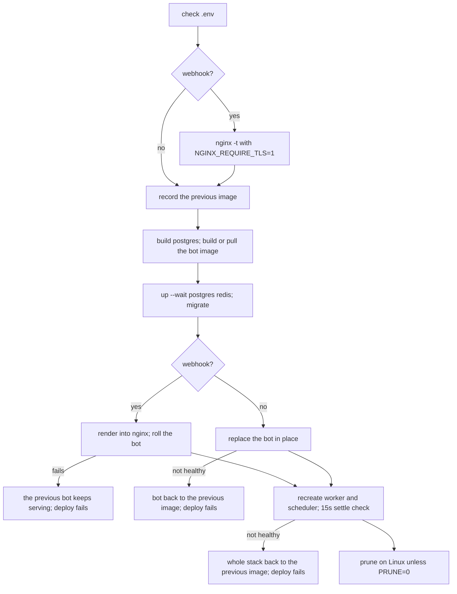

# Deployment

How the bot gets onto a server and stays up to date there: webhook mode
behind nginx, provisioning a fresh server, what `infra/deploy/deploy.sh` does
step by step, continuous deployment from GitHub Actions, and releases. Open
it before the first deploy, and again when a deploy fails and you need to
know what state it left behind. Every key named here is described in
[the configuration reference](configuration.md).

## Webhook mode

Polling, the default, needs nothing but outbound access to Telegram. Webhook
mode needs a public HTTPS origin. Set in `.env`:

- `BOT_MODE=webhook`;
- `WEBHOOK_BASE_URL`, the public `https` origin Telegram calls, on port 443
  (nginx takes the webhook on no other port);
- `WEBHOOK_SECRET`, 32 to 256 letters, digits, `_` or `-`, which Telegram
  echoes on every update;
- `COMPOSE_PROFILES=webhook`, which adds the nginx and certbot services.

The bot refuses to start in webhook mode without an `https` base URL and a
secret, and `make check-env` refuses a `COMPOSE_PROFILES` that disagrees with
`BOT_MODE`. Keep `WEB_SERVER_HOST` at `0.0.0.0`: nginx reaches the bot over
the compose network. The bot sets the webhook on every start and keeps it on
shutdown, so Telegram queues updates while the next container starts.

## nginx and the certificate

nginx publishes ports 80 and 443, the only ports of the stack open to the
internet. `infra/nginx/render.sh` renders its configuration from
`WEBHOOK_BASE_URL`, `WEBHOOK_PATH` and `TELEGRAM_ALLOWED_SUBNETS` when it
starts, and every webhook deploy renders it again. On 443 nginx:

- passes `WEBHOOK_PATH` to the bot only for `POST` requests from Telegram's
  subnets (`TELEGRAM_ALLOWED_SUBNETS`);
- passes `/live`, `/ready` and `/health` only from private addresses
  (loopback, `10.0.0.0/8`, `172.16.0.0/12`, `192.168.0.0/16`). The compose
  bridge gateway is excluded: Docker forwards connections to published ports
  from that address, so allowing it would open the probes to the internet;
- closes everything else with `444`, no answer at all, and refuses a TLS
  handshake for any other host name.

Port 80 answers the ACME challenge for the webhook host and nothing else.

Issue the first certificate once DNS for the webhook host points at the
server and port 80 is open. `DOMAIN` is the host of `WEBHOOK_BASE_URL`:

```bash
make cert-issue DOMAIN=bot.example.com EMAIL=you@example.com
```

Until a certificate exists nginx serves port 80 only. `NGINX_REQUIRE_TLS=1`
turns a missing certificate into an error: `make cert-issue` ends with
`nginx -t` under it, and the deploy tests the configuration the same way
before it changes anything. certbot tries to renew twice a day and nginx
reloads every six hours, so a renewed certificate is in use within six hours.
`make clean` keeps the certificate volume: Let's Encrypt issues a
certificate for the same host at most five times a week.

## Server provisioning

`infra/ansible` turns a fresh Ubuntu 24.04 or 26.04 server into one CD can
deploy to: an `ops` user for you, a `deploy` user for CD, SSH on a port of your
choice with keys only, a firewall, Docker, and the checkout in
`/srv/<app_name>`. The inventory, the variables and what each role does are in
`infra/ansible/README.md`. The short path:

```bash
make ansible-deps                                  # Ansible in its own virtualenv
make server-bootstrap ENV=production               # once, as root
make server-provision ENV=production CHECK=1       # preview the changes
make server-provision ENV=production               # apply
```

`bot_mode` in the inventory must match `BOT_MODE` in the server's `.env`:
webhook opens ports 80 and 443, polling opens no web port.

The first deploy is by hand. Put `.env` in `/srv/<app_name>`, then as `deploy`
(`sudo -iu deploy`, `cd /srv/<app_name>`) run `make check-env`, in webhook
mode `make cert-issue DOMAIN=<host of WEBHOOK_BASE_URL>`, then
`bash infra/deploy/deploy.sh`.

## Deploying

On the server, from the checkout:

```bash
bash infra/deploy/deploy.sh
```

Two variables choose where the image comes from. `BUILD=1` builds it on the
server from the checkout, the default without `BOT_IMAGE`. `BUILD=0` pulls
`BOT_IMAGE`, an image CI pushed, the default with it:

```bash
BUILD=0 BOT_IMAGE=ghcr.io/<owner>/<repo>:sha-<12> bash infra/deploy/deploy.sh
```

`BUILD` and `PRUNE` accept only `0` or `1`. `BUILD=1` with `BOT_IMAGE` set is
refused, since a build would put the checkout's code under the pinned tag;
`BUILD=0` without `BOT_IMAGE` is refused, since the local tag exists in no
registry. The steps:

1. `scripts/ops/check_env.py` checks `.env`.
2. In webhook mode, `nginx -t` runs in a fresh nginx container with
   `NGINX_REQUIRE_TLS=1`, so a bad configuration or a missing certificate
   stops the deploy before anything changes.
3. The image id of the serving bot is recorded as the previous image (none on
   a first deploy).
4. The Postgres image is built (`build --pull postgres`); it stays local to
   the server.
5. With `BUILD=1`, `bot-builder` builds the bot image with `COMMIT_SHA` from
   the checkout; with `BUILD=0`, the bot image is pulled.
6. `up --wait postgres redis`, then the `migrate` service applies the
   migrations before any new code runs.
7. Webhook mode: nginx and certbot are started. A running nginx gets this
   checkout's configuration rendered into it, tested there and reloaded; when
   it refuses the new files, the previous ones are put back and the deploy
   stops. Then the bot rolls: nginx is pinned to the serving container, one
   more bot container starts beside it, it gets up to 120 seconds to turn
   healthy, nginx moves onto it, the nginx workers retired by the reload get
   up to 60 seconds to finish their requests, the old container stops, and
   nginx goes back to the service name. No update is refused.
8. Polling mode: nginx and certbot are removed if they were running, and the
   bot is replaced in place (`--force-recreate --wait`, up to 120 seconds).
   Two pollers on one token conflict, so it never runs two.
9. The worker and the scheduler are recreated with `up --wait`, up to 180
   seconds. 15 seconds later each must still be running with no restart.
10. On Linux, images created more than a week ago that no container uses and
    build cache unused for a week are pruned (`until=168h`); `PRUNE=0` keeps
    them.



A failed check or migration stops the deploy with the previous stack still
running, and every failure ends with exit code 1 and a `[deploy] ...` line.
When the bot, the worker or the scheduler does not come up, the stack goes
back to the previous image; on a first deploy there is none, and the deploy
fails. Migrations stay applied, so the previous code runs against the new
schema.

A rollback changes neither the checkout nor `.env`. The checkout stays at the
new commit, and when the deploy took its image from `BOT_IMAGE` in `.env` or
built the local tag, that still names the failed image: pin `BOT_IMAGE` to the
previous image, or deploy it again, before any plain `make run`.

The new bot serves while the old worker still runs, so a task the old worker
does not know is lost. Register a new task in one release and enqueue it from
a later one.

## Continuous deployment

CD is off until you turn it on. After CI passes on a push, `CD (prod)`
(`.github/workflows/prod_deploy.yml`) deploys `main` and `CD (stage)`
(`.github/workflows/stage_deploy.yml`) deploys `stage`. Each connects to the
server over SSH, checks out the commit CI tested, and runs
`infra/deploy/deploy.sh` with `BUILD=0` and that run's `sha-<12>` image from
GHCR, so the server never builds. A push of documentation only builds no
image and deploys nothing.

Deploys to one environment never run in parallel (concurrency group
`deploy-<environment>`), so two merges never migrate one database at once. A
running deploy is never cancelled, and of several waiting deploys only the
newest runs.

To turn it on for an environment:

1. Provision the server; `make server-provision` ends with the values below
   printed.
2. Settings -> Environments -> `production` (or `staging`):
   - secrets `SSH_PRIVATE_KEY`, `SSH_KNOWN_HOSTS`, `SSH_USER` (`deploy`) and
     `SERVER_IP`;
   - variables `APP_DIR` (`/srv/<app_name>`) and `SSH_PORT` (when not 22);
   - optional secrets `ALERT_BOT_TOKEN` and `ALERT_CHAT_ID`: a bot and chat
     that get one message per deploy. Without them the deploy runs and its
     log says no alert was sent.
3. Deployment branches of the environment: `main` for `production`, and
   both `main` and `stage` for `staging`. The deploy is triggered by
   `workflow_run`, which GitHub runs on the default branch, so an environment
   limited to `stage` rejects it.
4. Settings -> Secrets and variables -> Actions -> Variables: set
   `PROD_DEPLOY_ENABLED` (or `STAGE_DEPLOY_ENABLED`) to `true`.

To redeploy an earlier build, run the workflow by hand (Actions -> CD (prod)
-> Run workflow) with `image_tag` set to its `sha-<12>` tag. Only a commit of
the environment's branch is accepted. A blank `image_tag` deploys the tip of
that branch; when the tip is a documentation-only commit, CI built no image
for it and the deploy fails at the pull, so give the tag of the last code
commit instead.

## Releases

Tag a commit CI built and pushed with `vX.Y.Z` and push the tag. The
`Release` workflow (`.github/workflows/release.yml`) points
`ghcr.io/<owner>/<repo>:vX.Y.Z` at the image CI pushed for that commit with
`docker buildx imagetools create`: the same digest, nothing rebuilt. It then
opens a GitHub Release with generated notes and the image digest.

Wait until CI on that commit has finished. A tag pushed before its image
exists fails, and so does a tag on a commit CI never built, or one not shaped
`vX.Y.Z`. A release deploys nothing: CD follows the branches.
